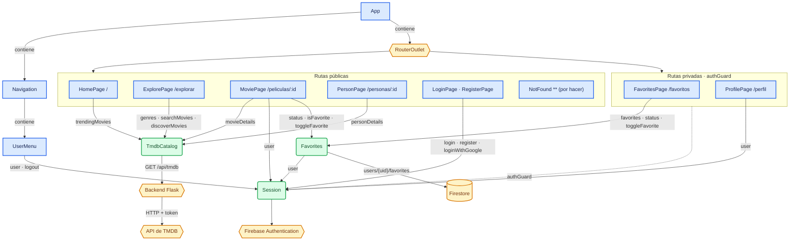

# Componentes y servicios · Arquitectura de Movies

## 1. Decisiones que fijan la arquitectura

| Decisión                                                  | Consecuencia en el código                                                                                                                                      |
| --------------------------------------------------------- | -------------------------------------------------------------------------------------------------------------------------------------------------------------- |
| Exploración pública; preferencias privadas                | Bienvenida, exploración y fichas sin guard. `/favoritos` y `/perfil` con `authGuard`.                                                                          |
| Firebase Authentication + Firestore                       | `Session` usa Firebase Auth y `Favorites` usa Firestore. Flask solo hace de proxy de TMDB.                                                                     |
| El alcance termina en favoritos                           | Un documento por favorita en `users/{uid}/favorites/{tmdbId}`: si existe, la película es favorita. Si algún día hubiera puntuaciones, irían en otra colección. |
| Búsqueda por título + género, nota mínima, orden y página | `ExplorePage` con dos modos: `searchMovies` o `discoverMovies`. No se usan `searchPeople` ni `searchKeywords`.                                                 |
| Fichas de actores y directores                            | Una sola `PersonPage`: interpretación (`cast`) y dirección (`crew` con `job === 'Director'`). Sin productores.                                                 |
| Datos ausentes → «no disponible»                          | Textos estándar en `es.json`. `place_of_birth` es lugar de nacimiento, no nacionalidad.                                                                        |
| Sin wireframes ni rúbrica                                 | Diseño según el briefing y los criterios del roadmap.                                                                                                          |

## 2. Mapa de rutas

| URL               | Página             | Acceso                       | Feature                  | Datos                                             |
| ----------------- | ------------------ | ---------------------------- | ------------------------ | ------------------------------------------------- |
| `/`               | `HomePage` ✅      | Pública                      | `features/home/`         | `trendingMovies('week')`                          |
| `/explorar`       | `ExplorePage` ✅   | Pública                      | `features/explore/`      | `genres`, `searchMovies` o `discoverMovies`       |
| `/peliculas/:id`  | `MoviePage` ✅     | Pública (favorito con login) | `features/movie-detail/` | `movieDetails`; `Favorites`                       |
| `/personas/:id`   | `PersonPage` ✅    | Pública                      | `features/person/`       | `personDetails`                                   |
| `/iniciar-sesion` | `LoginPage` ✅     | Pública                      | `features/access/`       | `Session.login`, `Session.loginWithGoogle`        |
| `/registro`       | `RegisterPage` ✅  | Pública                      | `features/access/`       | `Session.register`, `Session.loginWithGoogle`     |
| `/favoritos`      | `FavoritesPage` ✅ | Privada                      | `features/favorites/`    | `Favorites.favorites`, `status`, `toggleFavorite` |
| `/perfil`         | `ProfilePage` ✅   | Privada                      | `features/profile/`      | `Session.user`                                    |
| `**`              | `NotFound` ⬜      | Pública                      | `layout/not-found/`      | —                                                 |

✅ hecho · ⬜ por hacer.

- `app.routes.ts` carga cada feature en diferido (`loadChildren`); cada feature define sus rutas en su `*.routes.ts`. `''` con `pathMatch: 'full'` carga `features/home/home.routes.ts`.
- Los segmentos de las rutas privadas y de acceso viven en `core/config/paths.ts`: `login`, `register`, `profile` y `favorites` ✅ (`'favoritos'`). Los usan las rutas, los enlaces y el guard. `app.routes.ts` monta `ACCESS_ROUTES` (exportación con nombre) sobre `''`; el resto de features usan `export default`.
- `withComponentInputBinding()` está activado en `app.config.ts`: los parámetros (`:id`) y los query params llegan a las páginas como `input()`.
- Query params de `/explorar`: `q` y `pagina` en modo búsqueda; `genero`, `nota`, `orden` y `pagina` en modo descubrimiento.
- `authGuard` (`core/auth/auth-guard.ts`) espera a `Session.ready()` y, sin sesión, redirige a `/iniciar-sesion?returnUrl=<url>`. `LoginPage` y `RegisterPage` reciben `returnUrl` como `input()` y vuelven a esa URL tras entrar, también con Google (el botón emite `signedIn` y la página navega). `safeReturnUrl` solo acepta URLs internas, para evitar redirecciones abiertas.

## 3. Esquema general

Las flechas indican «muestra», «utiliza» o «lee/escribe», según su etiqueta.



Regla general: **solo las páginas** (y los componentes de sesión: `user-menu` y `google-sign-in`) inyectan servicios. Los componentes de `shared/ui` y los subcomponentes de cada feature reciben datos por `input()` y avisan por `output()`.

## 4. Servicios

Todos viven en `core/`, porque los usan varias features. Los nuevos se declaran con `@Service()` y sin sufijo `Service`.

### `TmdbCatalog` · `core/catalog/tmdb-catalog.ts` · ✅

Sin estado: cada método recibe la selección (signal o función) y devuelve un `httpResource`; la selección vive en la página.

| Método                                                        | Lo usa                                                                             |
| ------------------------------------------------------------- | ---------------------------------------------------------------------------------- |
| `trendingMovies(window)`                                      | `HomePage` (siempre `'week'`, sin selector)                                        |
| `genres()`, `searchMovies(search)`, `discoverMovies(filters)` | `ExplorePage`                                                                      |
| `movieDetails(id)`                                            | `MoviePage`                                                                        |
| `personDetails(id)`                                           | `PersonPage`                                                                       |
| `searchPeople`, `searchKeywords`                              | Nadie: quedan fuera del alcance. Se pueden borrar o conservar para una ampliación. |

### `Session` · `core/auth/session.ts` · ✅

Fachada de Firebase Authentication: los componentes nunca importan Firebase.

| Miembro                                      | Uso                                                                                                                                        |
| -------------------------------------------- | ------------------------------------------------------------------------------------------------------------------------------------------ |
| `user: Signal<AppUser \| null \| undefined>` | `undefined` mientras Firebase restaura la sesión. Lo leen `user-menu`, `ProfilePage`, `MoviePage` (botón o enlace al login) y `Favorites`. |
| `isLoggedIn: Signal<boolean>`                | `authGuard`.                                                                                                                               |
| `ready(): Promise<void>`                     | `authGuard`, para no redirigir antes de saber si hay sesión.                                                                               |
| `register(email, password, displayName)`     | `RegisterPage`.                                                                                                                            |
| `login(email, password)`                     | `LoginPage`.                                                                                                                               |
| `loginWithGoogle()`                          | `google-sign-in` (en `LoginPage` y `RegisterPage`). Ampliación sobre el MVP.                                                               |
| `logout()`                                   | `user-menu` (tras cerrar sesión navega a `/` para salir de cualquier página privada).                                                      |
| `getIdToken()`                               | Nadie: con Firestore y reglas no hace falta enviar el token a Flask.                                                                       |

Los métodos de acción envuelven el error de Firebase en `AuthError`, cuya `key` (`AuthErrorKey`) es una clave de `TEXTS.auth.errors`; `null` significa «no mostrar nada» (por ejemplo, el usuario cerró el popup de Google). Las funciones de Firebase se inyectan con `FIREBASE_AUTH_API` (`core/auth/firebase-auth.ts`) para poder sustituirlas en los tests.

Junto a él: `authGuard`, `safeReturnUrl`, `AppUser`, `AuthError`, `authErrorKey` y `FIREBASE_AUTH` / `FIREBASE_AUTH_API`.

### `Favorites` · `core/favorites/favorites.ts` · ✅

**Este servicio sí guarda estado**, a diferencia de `TmdbCatalog`: las favoritas son del usuario, no de una pantalla, y `MoviePage` y `FavoritesPage` deben ver los mismos datos al instante.

| Miembro                                               | Descripción                                                                                                                                                                                                                  |
| ----------------------------------------------------- | ---------------------------------------------------------------------------------------------------------------------------------------------------------------------------------------------------------------------------- |
| `favorites: Signal<FavoriteMovie[]>`                  | Lista en tiempo real (`onSnapshot`), de la más reciente a la más antigua (`orderBy('addedAt', 'desc')`). Vacía sin sesión.                                                                                                   |
| `status: Signal<'loading' \| 'ready' \| 'error'>`     | Distingue «cargando» de «lista vacía». Sin sesión vale `'ready'`; mientras Firebase restaura la sesión, `'loading'`.                                                                                                         |
| `isFavorite(tmdbId): boolean`                         | Recorre la lista con `some`. Si se llama dentro de un `computed`, este se recalcula al cambiar la lista.                                                                                                                     |
| `toggleFavorite(movie: FavoriteMovie): Promise<void>` | Si ya es favorita, borra su documento (`deleteDoc`); si no, lo crea con `addedAt: serverTimestamp()` (`setDoc`). Rechaza la promesa si no hay sesión o Firestore no guarda, para no mostrar como guardado lo que no lo está. |

Un `effect` sobre `Session.user()` abre la escucha de Firestore al iniciar sesión y la cierra con `onCleanup` al cerrar sesión o cambiar de cuenta. `FavoriteMovie` (`favorite-movie.ts`) es el resumen que se guarda: `tmdbId`, `title`, `posterPath`, `releaseDate`. Las funciones de Firestore se inyectan con `FIRESTORE_API` para poder simularlas en los tests, igual que en `Session`.

### Inicialización de Firebase · `core/firebase/` · ✅

SDK oficial de Firebase (paquete `firebase`, sin AngularFire), inicializado una sola vez mediante `InjectionToken`:

- `FIREBASE_APP` (`firebase-app.ts`) llama a `initializeApp(firebaseConfig)`.
- `FIREBASE_AUTH` (`core/auth/firebase-auth.ts`) y `FIRESTORE` (`firestore.ts`) se derivan de él, así `initializeApp` no se llama dos veces.
- En los tests se sustituyen por dobles.

## 5. Modelo de datos en Firestore

```text
users/{uid}/favorites/{tmdbId}     privado: solo su dueño lee y escribe
  tmdbId: number
  title: string
  posterPath: string | null
  releaseDate: string
  addedAt: timestamp               lo pone el servidor (serverTimestamp)
```

- Si el documento existe, la película es favorita: añadir lo crea y quitar lo borra.
- `FavoritesPage` pinta la lista con este resumen, sin pedir cada película a TMDB. Al pulsar una se abre `MoviePage`, que sí trae los datos actualizados.
- No hay datos que migrar desde el modelo anterior (`users/{uid}/movies` con `favorite` y `rating`), que nunca llegó a usarse.

### Reglas de seguridad (`firestore.rules`, raíz del repositorio)

```text
match /users/{uid}/favorites/{movieId} {
  allow read, write: if request.auth != null && request.auth.uid == uid;
}
```

- Cada usuario solo lee y escribe sus propias favoritas. El `authGuard` del frontend no sustituye estas reglas.
- Las reglas se publican desde la consola de Firebase (pestaña Reglas: pegar el archivo y Publicar).
- Mejora posible: validar los tipos de los campos y que `tmdbId` coincida con el ID del documento. Probarlo con el emulador de Firestore.

## 6. Componentes de cada página

Las flechas significan «contiene». Verde: hecho · azul: por hacer.

```mermaid
flowchart TD
    Home["HomePage"] --> Card["movie-card"]

    Explore["ExplorePage"] --> Search["search-box"]
    Explore --> Filters["filters-panel"]
    Explore --> Card
    Explore --> Pagination["pagination"]

    Movie["MoviePage"] --> Credits["credits"]
    Movie --> Videos["videos"]
    Movie --> FavButton["favorite-button"]

    Person["PersonPage"] --> Card

    FavPage["FavoritesPage<br/>(lista en su propia plantilla)"]

    Access["LoginPage · RegisterPage"] --> Forms["formularios reactivos"]
    Access --> Google["google-sign-in"]

    Nav["Navigation"] --> UserMenu["user-menu"]

    Layout["NotFound · Footer"]

    classDef done fill:#DCFCE7,stroke:#16A34A,color:#14532D,stroke-width:2px
    classDef todo fill:#DBEAFE,stroke:#2563EB,color:#172554,stroke-width:2px
    class Home,Card,Explore,Search,Filters,Pagination,Movie,Credits,Videos,Person,Access,Forms,Google,Nav,UserMenu,FavButton,FavPage done
    class Layout todo
```



| Componente               | Carpeta                  | Entradas → salidas                                                                                                                                                                |
| ------------------------ | ------------------------ | --------------------------------------------------------------------------------------------------------------------------------------------------------------------------------- |
| `movie-card` ✅          | `shared/ui/`             | `movie: Movie` (datos de TMDB). Usado en Home, Explorar y la filmografía de Persona.                                                                                              |
| `pagination` ✅          | `shared/ui/`             | `page`, `totalPages` → `pageChange`. Se oculta con una sola página. El límite de 500 páginas de TMDB lo aplica la página que lo usa.                                              |
| `favorite-button` ✅     | `shared/ui/`             | `active`, `disabled` → `toggled`. Botón con `aria-pressed`, texto fijo «Favorita» y estrella oculta a lectores de pantalla (`aria-hidden`).                                       |
| `search-box` ✅          | `features/explore/`      | `query` → `queryChange`: `FormControl` + `debounceTime(400)`, Intro busca sin esperar, no repite el mismo texto.                                                                  |
| `filters-panel` ✅       | `features/explore/`      | `genres`, `filters`, `disabled` → `filtersChange`, `reset`. `FormGroup` con género, nota mínima (5-9) y orden.                                                                    |
| `credits` ✅             | `features/movie-detail/` | `cast`, `crew`. Quién dirige y los 10 primeros del reparto, enlazados a `/personas/:id`.                                                                                          |
| `videos` ✅              | `features/movie-detail/` | `videos` → enlace al primer tráiler de YouTube o «Tráiler no disponible».                                                                                                         |
| `filmography.ts` ✅      | `features/person/`       | No es un componente: `newestFirst(a, b)` ordena de la más reciente a la más antigua.                                                                                              |
| `google-sign-in` ✅      | `features/access/`       | Sin entradas → `signedIn`. Inyecta `Session`, llama a `loginWithGoogle()` y muestra el error de `TEXTS.auth.errors`; la página que lo contiene navega a `returnUrl`.              |
| `passwords-match.ts` ✅  | `features/access/`       | Validador de grupo de `RegisterPage`: contraseña y confirmación iguales.                                                                                                          |
| `navigation` ✅          | `layout/navigation/`     | `<header>` con `<nav aria-label="Principal">` (Inicio y Explorar) y `user-menu`. «Saltar al contenido» y `<main>` están en `app.html`.                                            |
| `user-menu` ✅           | `layout/user-menu/`      | Inyecta `Session` y `Router`. Con sesión: nombre, «Mi perfil», «Mis favoritas» ✅ y «Cerrar sesión». Sin ella: enlaces a acceso y registro. Mientras se restaura la sesión, nada. |
| `not-found`, `footer` ⬜ | `layout/`                | Todavía no existen. El pie es buen sitio para la atribución de TMDB.                                                                                                              |

Decisiones de simplicidad tomadas por el camino:

- **No se crearon** `movie-list-item` ni `person-card`. `FavoritesPage` pinta cada favorita en su plantilla (no puede usar `movie-card`, que espera una `Movie` de TMDB) y `credits` pinta cada persona en la suya. Se extraen solo si otra página los necesita.
- **No se extrajeron** `loading-state`, `error-state` ni `empty-state`: los estados siguen dentro de la plantilla de cada página. Se puede hacer en una rama propia, junto con los estilos repetidos de `.grid`.

### Comportamiento clave por página

- **`ExplorePage`** ✅: con `q` en la URL usa `searchMovies` y desactiva `filters-panel`, porque `/search/movie` de TMDB no admite filtros. Sin `q` usa `discoverMovies`. El recurso del modo que no se ve se desactiva. Cambiar un criterio vuelve a la página 1 y actualiza la URL.
  - Query params como `input()`, validados con funciones puras de `explore-params.ts`. Los hijos emiten y la página solo cambia la URL (`router.navigate` con `queryParamsHandling: 'merge'`). Al cambiar de página, el foco va al título de resultados.
  - Ordenar por nota o por fecha añade `vote_count.gte=100`, para evitar películas con muy pocos votos o sin estrenar.
- **`MoviePage`** ✅: `id = input<string>()`; `movieId = computed(...)` lo convierte en número o `undefined`; `movie = catalog.movieDetails(movieId)`. Muestra título, lema, póster, estreno, duración, géneros, nota de TMDB con votos, sinopsis, `credits` y `videos`. Estados: ID no válido, cargando, error con «Reintentar» y datos. Cada dato ausente muestra «No disponible».
  - Favorito: mientras se restaura la sesión no muestra nada; sin sesión, un enlace a `/iniciar-sesion?returnUrl=…`; con sesión, `favorite-button`, desactivado mientras `Favorites.status()` no es `'ready'`. `saving` evita los dobles clics sin desactivar el botón (para que no pierda el foco). Los errores de carga y de guardado se anuncian en un `role="alert"`.
  - Por hacer: título de pestaña con el nombre de la película (hoy es fijo).
- **`PersonPage`** ✅: mismo patrón que `MoviePage`. `actingMovies` y `directedMovies` son `computed` ordenados con `newestFirst`; cada sección se oculta si está vacía. Por hacer: título de pestaña con el nombre.
- **`LoginPage`** ✅ y **`RegisterPage`** ✅: formularios reactivos (`NonNullableFormBuilder`) con errores accesibles; al enviar con errores enfocan el primer campo no válido. Desactivan el envío mientras esperan, muestran el error de `TEXTS.auth.errors` y vuelven a `returnUrl` (o a `/`).
- **`ProfilePage`** ✅: nombre (o «Sin nombre»), correo y foto si la hay.
- **`FavoritesPage`** ✅: lee `favorites` y `status` del servicio, sin copia propia. Estados: cargando, error, vacía (con enlace a Explorar) y lista con póster, título enlazado, año y «Quitar». Quitar llama a `toggleFavorite` y la fila desaparece cuando `onSnapshot` actualiza la lista.
- **Todas**: comprobar `isLoading()`, `error()` y `hasValue()` antes de leer `value()` de un `httpResource`; un ID no válido muestra un mensaje de navegación inválida.

## 7. Árbol de carpetas

```text
src/app/
├── app.ts · app.html · app.config.ts · app.routes.ts
├── core/
│   ├── catalog/        tmdb-catalog.ts ✅ · models/ ✅
│   ├── auth/           session.ts ✅ · auth-guard.ts ✅ · safe-return-url.ts ✅ · app-user.ts ✅
│   │                   auth-error.ts ✅ · auth-error-key.ts ✅ · firebase-auth.ts ✅
│   ├── firebase/       firebase-app.ts ✅ · firestore.ts ✅
│   ├── favorites/      favorites.ts ✅ · favorite-movie.ts ✅ · favorites.feature ✅
│   └── config/         api.ts ✅ · texts.ts ✅ · firebase.ts ✅ · paths.ts ✅
├── shared/
│   ├── ui/             movie-card ✅ · pagination ✅ · favorite-button ✅
│   └── pipes/          tmdb-image ✅ · year ✅
├── layout/             navigation ✅ · user-menu ✅ · footer ⬜ · not-found ⬜
└── features/
    ├── home/           home-page ✅ · home.routes.ts ✅ · home.feature ✅
    ├── explore/        explore-page ✅ · search-box ✅ · filters-panel ✅ · explore-params.ts ✅
    ├── movie-detail/   movie-page ✅ · credits ✅ · videos ✅ · movie-detail.feature ✅
    ├── person/         person-page ✅ · filmography.ts ✅ · person.feature ✅
    ├── access/         login-page ✅ · register-page ✅ · google-sign-in ✅ · passwords-match.ts ✅
    ├── profile/        profile-page ✅
    └── favorites/      favorites-page ✅ · favorites.routes.ts ✅ · favorites.feature ✅
firestore.rules         (raíz del repositorio)
```

## 8. Integración en GitHub

Acuerdos y configuración vigentes desde el 5 de octubre de 2026:

- `develop` está protegida en GitHub: **solo se integra mediante pull request**. No se hace push directo a `develop`; se sube la rama `feat/...` y se abre un PR hacia `develop`.
- Al aceptar un PR se usa **«Create a merge commit»** (equivalente a `--no-ff`), no _squash_ ni _rebase_.
- Tras el merge, se actualiza `develop` local con `git pull --ff-only`.
- El código nuevo **no lleva comentarios**: las explicaciones van en documentos aparte.
